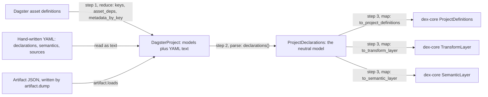
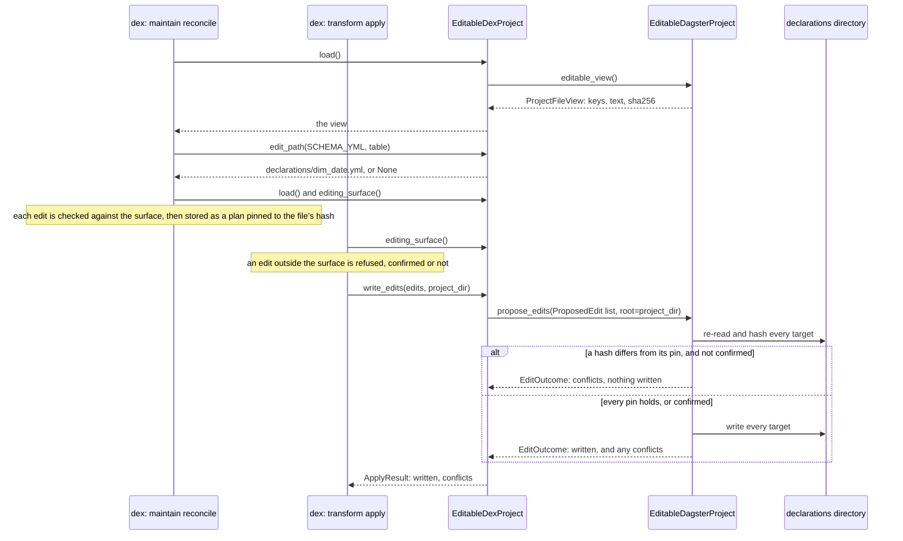
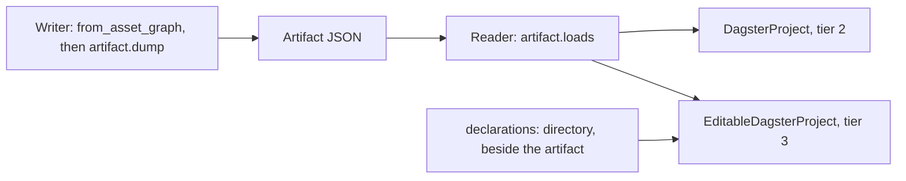

# Dagster to dex: how an asset graph becomes a project dex can read

- **Status:** living
- **Describes:** `src/dagster_dex/project.py`, `src/dagster_dex/declarations.py`,
  `src/dagster_dex/model.py`, `src/dagster_dex/dex.py`,
  `src/dagster_dex/artifact.py`, `src/dagster_dex/protocol.py`
- **Reviewed:** 2026-10-30 at `c4e8231`

This page describes how the translation works today. It decides nothing: each
decision it touches is linked where it is made, and a change to one is made
there, not here. The header convention is in [README.md](README.md).

## The translation, in three steps



1. **Reduce.** The Dagster objects become plain data: a sorted tuple of
   `dagster_dex.model.ProjectModel`, held by a `dagster_dex.project.DagsterProject`
   beside the declaration YAML as unparsed text.
2. **Parse.** `dagster_dex.project.DagsterProject.declarations` runs three
   parsers over that text, cross-checks what they find against the models, and
   returns one `dagster_dex.model.ProjectDeclarations`: the neutral model.
3. **Map.** `src/dagster_dex/dex.py` maps that value onto the three types
   dex-core's project seam asks for.

Steps 1 and 2 run with neither Dagster nor dex-core installed. Step 3 needs the
`[dex]` extra, and `dex.py` is the only module that imports dex-core
([AGENTS.md, *The rule that matters most here*](../../AGENTS.md#the-rule-that-matters-most-here)).
Why the neutral model exists at all, rather than reusing dex-core's, is the
module docstring of `src/dagster_dex/model.py` and README,
[*Four model decisions worth arguing about*](../../README.md#four-model-decisions-worth-arguing-about).

## Step 1: Dagster to plain data

`dagster_dex.project.DagsterProject.from_asset_graph` hands its definitions to
`dagster_dex.project._reduce_asset_graph`, which reads three attributes of each
one. They are named as a structural protocol,
`dagster_dex.project._AssetDefinition`, so nothing in the package imports
`dagster`; the `[dagster]` extra is a caller's convenience.

| Dagster attribute | What is read | Lands in |
| --- | --- | --- |
| `keys` | the last element of each key's `path` | `ProjectModel.name` |
| `asset_deps[key]` | the last element of each dependency's `path`, sorted | `ProjectModel.depends_on` |
| `metadata_by_key[key]` | the `layer` entry, lowercased, when present | `ProjectModel.layer` |
| nothing | | `ProjectModel.relation` stays `None` |

Nothing else on a definition is read: not its code, partitions, checks or IO
managers. Two consequences:

- **Only the last path element survives**, so a key prefix is dropped. Two
  definitions whose names collide after case folding raise `ValueError`,
  checked against the raw definitions. The reasons for both are in the
  `dagster_dex.project.DagsterProject.from_asset_graph` docstring.
- **A dependency is kept whatever it points at.** Filtering to built models
  happens at step 3, where dex-core's meaning of a ref applies, not here.

## Step 2: the declarations, and the neutral model

An asset graph carries no column names, keys or joins. They come from
hand-written YAML, handed to the project as three mappings of `{key: text}`:

| Constructor argument | Config option | Parser | Yields |
| --- | --- | --- | --- |
| `declaration_sources` | `declarations:` | `dagster_dex.declarations.parse_declarations` | `DeclaredKey`, `DeclaredJoin` |
| `semantic_sources` | `semantics:` | `dagster_dex.declarations.parse_semantics` | `SemanticModel`, `Metric` |
| `source_declarations` | `sources:` | `dagster_dex.declarations.parse_source_declarations` | `ExternalSource` |

The YAML is written in dbt's schema-test vocabulary (`unique`, `not_null`,
`relationships`), and that vocabulary is an input format, not the model:
everything lands in `src/dagster_dex/model.py` types, so changing the input
format touches `src/dagster_dex/declarations.py` alone (its module docstring).
No parser raises on bad input. A file that is not readable YAML becomes a
note and is skipped; one that parses to something other than a mapping is
skipped with no note.

- **Keys.** Read from a directory, a key is `<directory name>/<file name>`.
  Two parsers use it only as a label in notes. `parse_source_declarations`
  reads the key's stem as the model doing the reading, and sets
  `ExternalSource.declared_in` only when the key names a file
  ([AGENTS.md, *Sharp edges*](../../AGENTS.md#sharp-edges)).
- **Semantic columns.** `SemanticField.column` is set only when the field's
  `expr:` is a bare column name; an expression or a missing `expr:` leaves it
  `None`, with a note (the `dagster_dex.declarations._semantic_fields`
  docstring).
- **Sources are declared, never inferred** from the graph
  ([README, *External sources*](../../README.md#external-sources-the-edge-a-graph-cannot-see)).

`declarations()` then cross-checks. A key on, a join from, or a source read by
a model the graph does not build is kept, with a note naming the model. A
join's far side is not checked, because it may name a source (the
`dagster_dex.model.DeclaredJoin` docstring). `freshness` is always
`NOT_APPLICABLE`, because nothing compiled sits between the graph and the
reduction. The result is memoized for the instance's life, which is one command.

## Step 3: the neutral model to dex-core's types

`dagster_dex.dex.DexProject` wraps a project in dex-core's names: `format`
becomes `name`, and `declarations()` becomes `definitions()`, beside
`transform_layer()` and `semantic_layer()`. That is dex-core's tier 2. Why the
names differ is in
[AGENTS.md, *The names in `protocol.py` are OURS*](../../AGENTS.md#the-names-in-protocolpy-are-ours-and-must-not-be-fixed-to-match).

Each channel below is one function. A loss the target type cannot hold is
disclosed in that type's own `notes`, and each table's last column says which
note carries it. That both layers carry their notes, and why the tests assert
on the layer, is in [AGENTS.md, *Sharp edges*](../../AGENTS.md#sharp-edges).

### Explore: `dagster_dex.dex.to_project_definitions`

| Neutral model | `ProjectDefinitions` | Lost | Disclosed by |
| --- | --- | --- | --- |
| `DeclaredKey`, one column | `DeclaredKey`, `unique=True`, `not_null=False` | nothing | |
| `DeclaredKey`, several columns | `DeclaredCompositeKey` | nothing | |
| `DeclaredJoin`, one column a side | `DeclaredForeignKey` | nothing | |
| `DeclaredJoin`, several columns | omitted | the join | a note listing each omitted join |
| `freshness` of `NOT_APPLICABLE` | `manifest_loaded=False`, `manifest_stale=False` | the third state | a note that `False` means not applicable |
| model names | `built_relation_names`, lowercased | case | |
| each semantic model's `model` | `metric_models` | nothing | |
| no project directory | `project_dir=None` | nothing | |
| `is_empty` | `present`, negated | nothing | |
| `notes` | `notes`, first | nothing | |

`relationship_source` and `semantic_source` are both `"declaration"`.

### Maintain, transform half: `dagster_dex.dex.to_transform_layer`

| Neutral model | `TransformLayer` | Lost | Disclosed by |
| --- | --- | --- | --- |
| no files | `files={}` | file-content drift | a note that file hashes are absent, whenever there are models |
| model names | `models`, sorted | nothing | |
| `depends_on` | `model_refs`, built models only, self-references dropped | every other dependency | a note listing each dependency on neither a built model nor a declared source; one on a declared source is dropped unlisted |
| `ExternalSource` | `SourceTable`: `system` as `source_name`, `schema_name`, `table`, `columns` | nothing | |
| `ExternalSource.declared_in` | `SourceTable.path`, or `None` | a place, for text handed over in memory | none: `None` says it |
| `ExternalSource.read_by` | `model_sources`, each reader to sorted `system.table` identifiers | nothing | |

### Maintain, semantic half: `dagster_dex.dex.to_semantic_layer`

| Neutral model | `SemanticLayer` | Lost | Disclosed by |
| --- | --- | --- | --- |
| `SemanticModel` | `SemanticModelDef`, `path=None`, `model_ref` from `model` | nothing | |
| `definition_sha` | `content_sha256` | nothing | |
| dimensions and measures | `dimensions`, `measures`: name to column | the check, where a column is `None` | a note listing each field with no column |
| a categorical dimension with a column | `categorical_dimensions` | nothing | |
| a categorical dimension with no column | absent from `categorical_dimensions` | the flag | the same note |
| no entities | `entities={}` | entity checks | a note, whenever there are semantic models |
| `Metric.measure` | `MetricDef.input_measures`, `input_metrics=[]` | nothing | |
| `Metric.kind` | no field | the kind | a note listing each kind other than `simple` |

`dagster_dex.dex.DexProject.notes` returns the transform notes and then the
semantic notes in one call, and `dagster_dex.dex.transform_layer_notes` and
`dagster_dex.dex.semantic_layer_notes` stay public for a host that wants them
without building a layer.

## Write-back: the one edit that can land

Which class a configuration gets is decided in
`dagster_dex.dex.project_from_context`: a named `declarations:` directory builds
`dagster_dex.dex.EditableDexProject` over
`dagster_dex.project.EditableDagsterProject`, and anything else builds the
read-only pair. Why it is a class and not a flag, and which cases the tests
pin, are in
[AGENTS.md, *Tier 3 is reached by ONE class*](../../AGENTS.md#tier-3-is-reached-by-one-class-and-the-split-is-the-design)
and [README, *The seam, in three tiers*](../../README.md#the-seam-in-three-tiers).

- **Root.** The declarations directory's parent; every key is relative to it.
- **Surface.** The declarations directory's name. On the graph route a
  `semantics:` or `sources:` directory under the same parent joins it; on the
  artifact route it stands alone. `dagster_dex.project._within` checks a key
  against the surface by path segment, and again at write time.
- **Placement.** `dagster_dex.dex.EditableDexProject.edit_path` answers
  `SCHEMA_YML` and returns `None` for every other kind. Its `model` argument
  is the warehouse table, matched against the stems of the declaration files
  in the view without regard to case, under `.yml` or `.yaml`. One match is
  that file; two or more are `None`; none is `<directory>/<table>.yml` as the
  table spells it. Reconcile reads the model from the placed file's stem, so a
  file declaring several models gets a warning and no edit.



- **`load()` and the write read different moments.** The view is built from
  the text the project was constructed with; `propose_edits` re-reads every
  target from disk. The reasons are in the docstrings of
  `dagster_dex.project.EditableDagsterProject.editable_view` and
  `dagster_dex.project.EditableDagsterProject.propose_edits`.
- **All-or-nothing means "check every target, then write"**, not a
  transaction (the `dagster_dex.project.EditableDagsterProject.propose_edits`
  docstring).
- **The plan's directory wins.** `write_edits` passes dex's `project_dir` as
  `root`, so a configuration that moved under a stored plan meets a pin that
  does not hold.
- **`load()` returns this package's `dagster_dex.protocol.ProjectFileView`**,
  not dex-core's dbt view, which keeps dex on its format-neutral path.

The directory contracts consumers build on (a missing directory refused, an
empty one admitted, the parent as root) are in
[AGENTS.md, *Tier 3 is reached by ONE class*](../../AGENTS.md#tier-3-is-reached-by-one-class-and-the-split-is-the-design).

## The artifact transport: the same inputs, carried as text

`artifact:` is the second construction route. The side that has the graph runs
step 1 and writes the result as JSON with `dagster_dex.artifact.dump`, which
takes the reduced models and the declaration text as keyword arguments. The
side that answers requests reads it with `dagster_dex.artifact.loads`, which
returns a `dagster_dex.artifact.ProjectArtifact`, and runs steps 2 and 3
itself.



- **What it carries.** Exactly `DagsterProject`'s constructor arguments (the
  name, the reduced models, the three mappings of declaration text) plus
  `generated_at` and `schema_version`. It carries text, never parsed
  structures, so a project rebuilt from an artifact runs the same parsers and
  notes as one built from the graph (the `src/dagster_dex/artifact.py` module
  docstring).
- **What the reader checks.** `loads` requires `schema_version` to equal
  `dagster_dex.artifact.SCHEMA_VERSION`, and refuses anything it cannot read.
  `project_from_context` refuses a missing artifact, and refuses `semantics:`,
  `sources:` and `name:` beside one.
- **Which tier.** An artifact alone builds `DagsterProject`. A `declarations:`
  directory beside it builds the editable pair, and the directory supersedes
  the declaration text the artifact carries, disclosed in
  `dagster_dex.dex.EditableDexProject.notes`. Why it has to supersede is in
  [README, *Reaching the write tier over the artifact transport*](../../README.md#reaching-the-write-tier-over-the-artifact-transport).

When to use which route is in
[README, *Two ways to name the project*](../../README.md#two-ways-to-name-the-project-and-the-reason-there-are-two).

## What the translation does not do

- **It never edits a model.** `edit_path` returns `None` for `MODEL_SQL`;
  why only the declarations can receive an edit is in
  [AGENTS.md, *Tier 3 is reached by ONE class*](../../AGENTS.md#tier-3-is-reached-by-one-class-and-the-split-is-the-design).
- **It has no table-to-relation mapping.** `ProjectModel.relation` is `None`
  from the reduction, so placement uses the table name as the file stem rather
  than translating it through a guess.
- **It reports no file-content drift.** `files` is empty, and the transform
  layer's note says so rather than letting two empty mappings read as no change.
- **It does not infer sources** from dependencies, for the reason step 2 links.
- **It does not absorb a sibling project** in another format
  ([README, *What this is*](../../README.md#what-this-is)).

## Seeing it run

`examples/walk_the_whole_loop.py` runs the graph route on this page against a
local DuckDB warehouse, write-back included; it does not use the artifact
transport, which `scripts/drive_the_write_path_against_the_wheel.py` drives.
From the root of a clone, as the README gives it:

```bash
uv run --no-project --with-editable . --with 'dagster>=1.13' \
  --with exmergo-dex-core==1.8.0 --with sqlglot==30.13.0 --with duckdb \
  python examples/walk_the_whole_loop.py
```

The README's [*What it finds*](../../README.md#what-it-finds) explains the lines
it prints.
