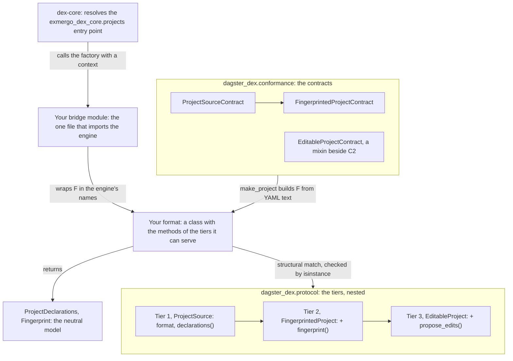

# Implementing a format: a second project format against the tiered seam

- **Status:** living
- **Describes:** `src/dagster_dex/protocol.py`, `src/dagster_dex/model.py`,
  `src/dagster_dex/conformance.py`, `src/dagster_dex/dex.py`,
  `tests/test_a_second_format.py`
- **Reviewed:** 2026-10-30 at `ec96fe4`

This page is for someone writing a project format of their own: a reader of
some other source of project truth that wants to be held to the same seam as
`dagster_dex.project.DagsterProject`, and proved by the contract this package
ships. It describes how the seam and the contract work today and decides
nothing: each decision it touches is linked where it is made. The header
convention is in [README.md](README.md), and the Dagster format itself is
walked through in [dagster-to-dex.md](dagster-to-dex.md).

## Where a format plugs in



A format is a class. It joins a tier by having that tier's methods, not by
inheriting anything or registering anywhere, and the contract for each tier is
a test class it subclasses. The engine reaches it through an entry point and a
factory, and only the bridge module knows the engine exists.

## The seam, in tiers

The three protocols are in `src/dagster_dex/protocol.py`, and the module
docstring is the argument for tiers over a single method. Each tier is a
superset of the one above:

- `dagster_dex.protocol.ProjectSource` is a `format` string and
  `declarations()`. `format` names the format, not the instance; the contract
  requires it non-empty and the same on every instance.
- `dagster_dex.protocol.FingerprintedProject` adds `fingerprint()`, which is
  what lets the project be a drift baseline.
- `dagster_dex.protocol.EditableProject` adds `propose_edits()`, the write
  path.

**Neither read method may raise.** An absent, ambiguous or unreadable project
returns empty declarations with a note saying why; the reason, and why it is
the property a shape check cannot see, is the
`dagster_dex.protocol.ProjectSource.declarations` docstring.

**The tiers are matched, not declared.** All three are `runtime_checkable`
protocols, so `isinstance` asks whether the members are present (the
`format` attribute as well as the methods), and
`dagster_dex.protocol.tier_of` asks from the most specific tier down. Why that
beats a capability flag is in the module docstring and in
[README, *The seam, in three tiers*](../../README.md#the-seam-in-three-tiers).
The consequence for an implementer is that a method is a claim: a format
that has `propose_edits` and refuses every call at runtime still matches tier 3,
and a caller learns the truth from an empty result that looks like success. So
a format that serves a tier for some instances and not others picks the class
per instance, and this package does exactly that
([AGENTS.md, *Tier 3 is reached by ONE class*](../../AGENTS.md#tier-3-is-reached-by-one-class-and-the-split-is-the-design)).

**Choosing tiers.** Each tier has one question, and the README table states
them. Answer each about the artifact, not about the format's origin: the
`dagster_dex.protocol.EditableProject` docstring says the write tier turns on
whether the thing an edit lands in is a source of truth a human keeps, and a
format can hold both kinds at once. Declining a tier is a complete answer. A
format at tier 1 still contributes declared keys and joins; one at tier 2 is a
drift baseline that nothing writes to. Neither is a partial implementation.

**The write tier's vocabulary** is five frozen dataclasses in the same module,
and each docstring states its contract:

| Type | What it carries |
| --- | --- |
| `dagster_dex.protocol.ProposedEdit` | a key in the format's own keyspace, new content (`None` deletes), the hash it was planned against (`None` creates) |
| `dagster_dex.protocol.EditOutcome` | `written` and `conflicts`, and no success flag |
| `dagster_dex.protocol.EditConflict` | a key, and the expected and found hashes |
| `dagster_dex.protocol.ProjectFileView` | the editable files keyed as the format keys them, and the `root` they are relative to |
| `dagster_dex.protocol.ProjectFile` | one file's key, content and hash, carried together |

`propose_edits` re-checks every pin before writing anything, refuses the whole
set on one conflict unless `confirmed`, and writes every target when confirmed
(the `dagster_dex.protocol.EditableProject.propose_edits` docstring).

**Placement sits beside the tiers, not inside them.** Saying where an edit of a
given kind lands, which keys an edit may touch, and what the editable files
hold now is dex-core's `PlacingProject`, not a protocol in this package. Here
it lives at the bridge, as `dagster_dex.dex.EditableDexProject.edit_path`,
`dagster_dex.dex.EditableDexProject.editing_surface` and
`dagster_dex.dex.EditableDexProject.load`, over
`dagster_dex.project.EditableDagsterProject.editing_surface` and
`dagster_dex.project.EditableDagsterProject.editable_view`. `tier_of` says
nothing about it, which is why the bridge tests decline it separately. `load()`
was called by two dex commands before any protocol declared it, so a format
could pass every assertion upstream shipped and fail at its first real
reconcile; that lesson, and the release that closed the gap, are in
[AGENTS.md, *`load()` was required by two callers*](../../AGENTS.md#load-was-required-by-two-callers-and-declared-by-no-protocol---fixed-upstream-lesson-kept).

## The neutral model a format produces

`declarations()` returns one `dagster_dex.model.ProjectDeclarations`, and
`fingerprint()` returns a `dagster_dex.model.Fingerprint`. The four decisions
that shape the model are argued in
[README, *Four model decisions worth arguing about*](../../README.md#four-model-decisions-worth-arguing-about)
and in the `src/dagster_dex/model.py` module docstring. What each asks of a
format:

- **A key is a tuple.** `dagster_dex.model.DeclaredKey` and
  `dagster_dex.model.DeclaredJoin` refuse empty columns at construction, and a
  join refuses sides of different lengths, so a format cannot build a key
  that says nothing.
- **There is no project directory.** A project is its `format` and `name`. A
  format that has a directory keeps it to itself, or puts it on
  `dagster_dex.protocol.ProjectFileView.root` for the write tier.
- **Freshness is a tri-state.** A format with no compiled artifact between its
  source and its reading reports `NOT_APPLICABLE`, not `FRESH`
  (`dagster_dex.model.Freshness`).
- **A required field is a refusal to invent.**
  `dagster_dex.model.ExternalSource` raises without a `system`; a format that
  does not know its source systems declares no sources.
  `dagster_dex.model.ProjectModel.relation` and
  `dagster_dex.model.SemanticField.column` stay `None` when the format cannot
  say, and the class docstrings give the reasons.

This package hashes with `dagster_dex.model.definition_hash` throughout, and
the `dagster_dex.protocol.ProjectFile` docstring says why the hash a view
hands out has to be the hash the write checks. What counts as a fingerprint
layer is the format's own choice (the `dagster_dex.model.Fingerprint`
docstring).

## The disclosure duty

`notes` is how a format says what it could not carry, and it is load-bearing:
a lossy mapping that cannot disclose itself reads as a clean one. The neutral
model carries it on `ProjectDeclarations` (its docstring), and at the engine
boundary each of dex-core's two tier-2 layers carries its own. Both are stated
in [AGENTS.md, *Sharp edges*](../../AGENTS.md#sharp-edges), with the rule for
testing them, which has two parts:

- **A loud arm and a quiet arm.** Assert the note appears when the loss
  happens, and is absent when it does not. Claiming a loss that did not happen
  is the same defect pointing the other way.
- **Assert on the layer, not on the function that feeds it.** A test that
  reads the source of a value cannot see it failing to arrive at the
  destination; dropping the argument that carries notes into a layer once left
  a whole suite green.

The contract reaches only part of the loud arm. For a malformed declaration,
a malformed source declaration, a source with no system and a semantic field
with no bare column it asserts that `notes` is not empty, so a format that
always emits one constant note passes all four. Only the redeclared field name
is checked by a note's wording. Whether a note discloses the loss that
happened, and the quiet arm, are the implementer's to test, because what a
format can lose depends on the format. The worked example below tests both
arms of the one note it adds.

## Proving it with `dagster_dex.conformance`

`src/dagster_dex/conformance.py` ships inside the package so that a format
outside this repository can run it (its module docstring). It needs pytest,
which the `test` extra installs.

### The contracts and their hooks

| Contract | Tier | Hook to implement |
| --- | --- | --- |
| `dagster_dex.conformance.ProjectSourceContract` | 1 | `make_project(declarations, semantics, sources)` |
| `dagster_dex.conformance.FingerprintedProjectContract` | 2, inheriting every tier-1 assertion | the same hook, returning a tier-2 project |
| `dagster_dex.conformance.EditableProjectContract` | 3, mixed in beside tier 2 | `an_edit_against_a_changed_target()` returning `(project, edits, read_target)` |

`make_project` receives three mappings of `{key: YAML text}`: declarations,
semantic definitions and source declarations, with `sources` keyed by the model
that reads the declared tables. The text is built by the module's fixture
builders (`dagster_dex.conformance.a_single_key_declaration`,
`dagster_dex.conformance.a_join_declaration`,
`dagster_dex.conformance.malformed_yaml` and the rest of its `__all__`), and it
is written in dbt's schema-test vocabulary. So a format passing the contract
reads that vocabulary, either natively or by translating it inside
`make_project`; the parsers in `src/dagster_dex/declarations.py` are one way
to read it.

The tier-3 contract is a separate mixin because a project that can receive an
edit has somewhere for the edit to land, and a hook shaped for text in memory
cannot produce one without inventing a place (the
`dagster_dex.conformance.EditableProjectContract` docstring). Its hook stages a
human editing the target after the edit was proposed, and must stage a fresh
scenario on every call, because one of the assertions writes.
`tests/test_conformance.py` wires both contracts to this package's formats and
is the worked example for tier 3.

### What the assertions check

They are behavioural, not structural: a format can satisfy every signature and
still raise on an absent project. In groups:

- **Shape.** The tier's protocol is satisfied, and `format` is stable and
  non-empty.
- **Never raises.** `declarations()` on an empty project, on malformed
  declarations and on a malformed source declaration; `fingerprint()` on an
  empty project. A format that raises fails these by the exception
  propagating; two of them also assert on what comes back.
- **Disclosure.** A note present in the cases the section above lists.
- **The declared channel.** A single-column key; a four-column key with its
  order kept; a join with both sides, including one whose two columns are named
  differently, so a format mirroring one side onto the other fails.
- **The semantic channel.** Models and metrics read; each field's column
  carried; a categorical dimension marked, including one with no column; an
  expression or a missing `expr` answered with `None`; a redeclared name keeping
  the first.
- **The source channel.** A source attributed to its reader; a source with no
  system skipped, not invented; one table declared twice as one source with two
  readers; a project declaring only sources not empty.
- **A vacuity guard**, so builders that stopped producing anything cannot
  leave the rest passing while measuring nothing, and `freshness` a
  `Freshness`, never a bare boolean.
- **Tier 2.** A fingerprint stable across calls, alike for identical projects,
  and changed by gaining a source or by moving one to another schema.
- **Tier 3.** An unconfirmed write over a moved target writes nothing; a
  confirmed one writes; the refusing outcome has conflicts and no written
  paths; the declared editing surface stays inside the project.

**Three things the contract asks beyond the protocol**, in
`src/dagster_dex/conformance.py`:

- A tier-2 assertion calls `changed_layers` on what `fingerprint()` returns,
  which the `ProjectFingerprint` protocol does not declare. Returning a
  `dagster_dex.model.Fingerprint` satisfies it. The call is marked in the
  source as asserted beyond the protocol on purpose.
- A tier-3 assertion calls `editing_surface()` on the project, which
  `EditableProject` does not declare, and is marked the same way.
- The redeclared-name assertion looks for `redeclare` in a note's text, the
  one place the contract reads a note's wording.

### What is promised to stay put

The builder names and the assertions are public surface: a format pins
against them, and renaming one is a breaking change (the module docstring).
One builder default is held for the same reason: `a_join_declaration` keeps
both sides named alike so an outside implementer's suite does not change
meaning underneath them, and the differently-named case is a separate
assertion (the
`dagster_dex.conformance.ProjectSourceContract.test_a_join_keeps_the_two_sides_apart_when_they_are_named_differently`
docstring). The seam has followed semantic versioning since 1.0.0
([README, *Status*](../../README.md#status)), so pin the major.

### A worked example

`tests/test_a_second_format.py` is a second format, in full, and the shortest
one this guide can honestly offer. `CatalogProject` reads its models from a
catalog, a mapping of model name to upstream names, and its declarations with
this package's parsers. It reports `NOT_APPLICABLE` freshness because it
compiles nothing, fingerprints the catalog as one layer and sources as another,
and adds one note of its own, for a key declared on a model the catalog does
not list, with a test for each arm: the note names the model when there is
one, and is absent when every key is on a listed model. It has no
`propose_edits`, and a test asserts that decline with `not isinstance` rather
than trusting the absence.

The wiring is one method:

```python
class TestCatalogProjectConformance(FingerprintedProjectContract):
    def make_project(self, declarations, semantics, sources):
        return CatalogProject(
            CATALOG,
            name="toy",
            declaration_sources=declarations,
            semantic_sources=semantics,
            source_declarations=sources,
        )
```

The file ends with two calibrations, because a contract observed only to pass
has not been shown to be one
([AGENTS.md, *Verification method*](../../AGENTS.md#verification-method)). One
plants a fingerprint blind to sources and asserts that the drift assertion
fails on it; the other plants a format that parses without a guard and asserts
that the never-raises assertion fails on it. Each runs the same assertion on
the honest format first.

It sits in `tests/`, so the engine-free control step runs it. To run it alone,
from the root of a clone:

```bash
uv run --no-project --with-editable . --with pytest==8.4.1 \
  python -m pytest tests/test_a_second_format.py
```

## What the contracts do not prove

They are behavioural, not exhaustive. Defects planted one at a time in this
package's `propose_edits` were mostly passed by the write-tier contracts
dex-core ships, which is why a driver runs this package's write path end to
end against the built wheel on every pull request, beside a second driver
that proves dex can read the project through it. The measurement and what
each driver proves are in
[AGENTS.md, *The two drivers, and why passing the contracts is not enough*](../../AGENTS.md#the-two-drivers-and-why-passing-the-contracts-is-not-enough).
The contracts in `dagster_dex.conformance` are behavioural in the same way,
and a green run of them is the same weaker claim.

A format that wants dex to read it also answers to the contracts dex-core
ships, and this package runs those too
([README, *Against dex-core's own contract*](../../README.md#against-dex-cores-own-contract)).
How the two suites divide the work, dex-core's judging the translation at the
boundary and this package's the mechanism, is the docstring of
`TestEditableDagsterProjectConformance` in `tests/test_conformance.py`.

## The boundary

**One format describes one kind of project.** This package does not absorb a
sibling project in another format, and the reason is the design argument
itself: two formats describing the same warehouse table is duplication. Where
two projects meet, the warehouse is the join
([README, *What this is*](../../README.md#what-this-is)). The contract
ships inside the package so that a format outside this repository can run it
(the
`src/dagster_dex/conformance.py` module docstring).

**How dex finds a format.** From dex-core 1.6.0 the engine resolves the
`exmergo_dex_core.projects` entry-point group, so an installed format can be
named in `.dex/config.yml` by its entry-point name; the other ways to name one
are in [README, *Status*](../../README.md#status). This package registers
`dagster = "dagster_dex.dex:project_from_context"` in `pyproject.toml`, and
the comment above that line records what pointing it at a class instead
cost. The value is a factory: dex calls it with one context and expects a
project in the engine's names back.

- **The context.** `dagster_dex.dex.ProjectContext` states the shape this
  package proposes for it: `repo_root`, where the engine was pointed or
  `None`, and `options`, the format's own non-secret coordinates passed
  through verbatim. Its docstring says why it has two fields rather than a
  path. `dagster_dex.dex.project_from_context` reads both with `getattr`, so
  it does not depend on whose class the context is.
- **The factory refuses what it cannot honor.** An unknown option is refused
  by name, and no secret belongs in `options`, because the configuration that
  names a format is committed. Construction runs once per command, so it
  should be cheap (the `dagster_dex.dex.project_from_context` docstring).
- **The factory picks the tier.** Which class it builds decides what the
  instance claims, so this is where a format that serves the write tier for
  some configurations and not others makes that choice.

**The engine coupling is one file.** `src/dagster_dex/dex.py` is the only
module that imports dex-core, which the control step proves by running the
suite with the engine uninstalled, and it imports public API only, which a
test walking its syntax tree asserts
([AGENTS.md, *The rule that matters most here*](../../AGENTS.md#the-rule-that-matters-most-here)).
`dagster_dex.dex.DexProject` is the wrapper pattern: the format keeps its own
vocabulary, and the bridge renames `format` to the engine's `name` and maps
`declarations()` onto the engine's types. The names in this package's
protocol differ from the engine's on purpose
([AGENTS.md, *The names in `protocol.py` are OURS*](../../AGENTS.md#the-names-in-protocolpy-are-ours-and-must-not-be-fixed-to-match)),
and a second format following this pattern has the same freedom.
