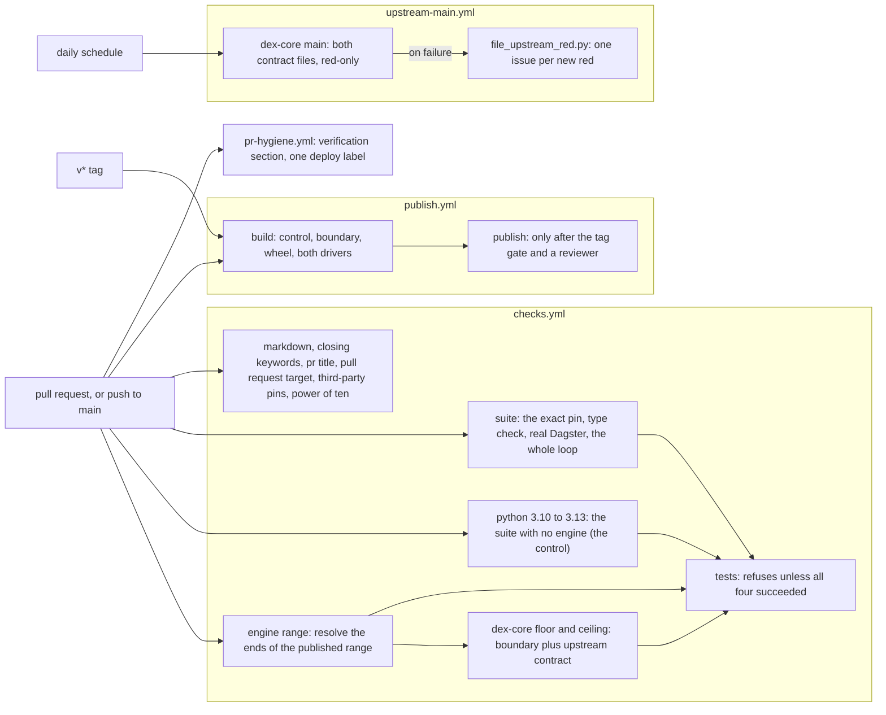

# Verification: how this package proves its claims

- **Status:** living
- **Describes:** `.github/workflows/checks.yml`, `.github/workflows/publish.yml`,
  `.github/workflows/upstream-main.yml`, `.github/workflows/pr-hygiene.yml`,
  `tests/conftest.py`, `tests/test_dex_bridge.py`, `tests/test_upstream_contract.py`,
  `tests/test_conformance.py`, `tests/test_write_tier.py`,
  `tests/test_criterion_guard.py`, `tests/test_documented_commands.py`,
  `tests/test_pin_coherence.py`, `tests/test_ascii_only.py`,
  `tests/test_readme_excerpt.py`, `tests/test_design_docs.py`,
  `tests/test_file_upstream_red.py`, `scripts/resolve_engine_range.py`,
  `scripts/file_upstream_red.py`, `scripts/check_readme_excerpt.py`,
  `scripts/drive_dex_against_the_wheel.py`,
  `scripts/drive_the_write_path_against_the_wheel.py`,
  `examples/walk_the_whole_loop.py`
- **Reviewed:** 2026-10-30 at `ec96fe4`

This page describes how the package's claims are checked today: which job
holds which claim, what each check can and cannot see, and where each one has
been shown to fail. It decides nothing. The rules it touches live in
[AGENTS.md](../../AGENTS.md), the method behind them in
[AGENTS.md, *Verification method*](../../AGENTS.md#verification-method), and
every command that runs a check in
[AGENTS.md, *Running the suite*](../../AGENTS.md#running-the-suite). The header
convention is in [README.md](README.md).

## The jobs, and what each one proves

| Job | Workflow | The claim it holds |
| --- | --- | --- |
| `python 3.x (engine-free)` | `checks.yml` | Everything but `src/dagster_dex/dex.py` runs with dex-core absent, on 3.10 to 3.13 |
| `engine range`, then `dex-core <version>` | `checks.yml` | The boundary and dex-core's own contract pass at both ends of the published `[dex]` range |
| `suite` | `checks.yml` | The demonstrated pin; the `py.typed` claim at the floor interpreter; the reduction and the scheduled-artifact sketch against real Dagster objects; the whole loop against a real warehouse; the README's quote of that run |
| `tests` | `checks.yml` | Every job above it succeeded, read explicitly |
| `build` | `publish.yml` | The distribution builds, and dex reads and writes a project through the built wheel |
| `dex-core main` | `upstream-main.yml` | The two contract files still pass against the unreleased head of dex-core; says nothing when they do |
| `pr-hygiene` | `pr-hygiene.yml` | The pull request says how it was verified and carries one `deploy:` label |

The required checks on `main` are `markdown`, `closing keywords` and `tests`,
read from the branch rules (the command is in
[AGENTS.md, *Change workflow*](../../AGENTS.md#change-workflow)). Everything
else here is advisory: `build` runs on every pull request and blocks nothing,
and `dex-core main` never runs on one. Why `tests` is an aggregate carrying
that one context, and why its name cannot change, is in
[AGENTS.md, *What CI runs that these three do not*](../../AGENTS.md#what-ci-runs-that-these-three-do-not).

## The engine-absent control

The package's central claim is that `src/dagster_dex/dex.py` is the only module
that imports `exmergo_dex_core`. It is held by running the suite with the engine
not installed: the `python-floor` job in `checks.yml`, on 3.10, 3.11, 3.12 and
3.13, and the first test step of `publish.yml`'s `build`.

- **How it fails.** A module that imports the engine at the top level raises
  `ModuleNotFoundError` when a test imports it, so collection errors and the
  step goes red. `dex.py` itself imports nothing from the engine at module
  level; every engine import sits inside the function that needs it, so the
  control can import `dagster_dex.dex` (as `tests/test_design_docs.py` does)
  without the engine.
- **What it leaves out, and how.** `tests/test_dex_bridge.py` and
  `tests/test_upstream_contract.py` are the files that need the engine. The
  control passes them as `--ignore`, rather than relying on their own
  skip-when-absent, because a skip reads as green.
- **Its red arm.** Measured on 2026-10-30 at `ec96fe4`: `import exmergo_dex_core`
  planted at the top of `src/dagster_dex/model.py` turned the control step into
  five collection errors (`test_artifact.py`, `test_conformance.py`,
  `test_packaging.py`, `test_project.py`, `test_write_tier.py`). There is no
  standing test that plants the import; the failure follows from Python's
  import machinery rather than from anything this repository wrote.

The rule that keeps the control a separate step is in
[AGENTS.md, *The rule that matters most here*](../../AGENTS.md#the-rule-that-matters-most-here).

### Public API only

`TestNoPrivateImports.test_the_boundary_module_imports_nothing_private` in
`tests/test_dex_bridge.py` parses `dex.py` and reads it rather than trusting
it. It walks the syntax tree, collects every `from exmergo_dex_core... import`
statement, and refuses a module path with a segment starting `_` or an imported
name starting `_`. It also asserts that it found at least one such import, so
a walk that matched nothing cannot pass.

What it does not read: a plain `import exmergo_dex_core._x` statement (it
reads `from` imports only), and an attribute reached after import. `dex.py`
uses `from` imports throughout today. It has no standing red arm; the
positive control is the non-empty assertion.

## The engine axes

Each axis is a different claim, so none of them can stand in for another.

| Axis | Job | Engine | Interpreter | The claim |
| --- | --- | --- | --- | --- |
| The demonstrated pin | `suite`, and `publish.yml`'s `build` | one exact version, written as a literal | the runner's | The mapping was demonstrated against this version, and every reproduction command names it |
| The published range | `engine-ends` | its floor and its ceiling, resolved | 3.13 | A consumer's resolver at either end gets a combination that ran |
| The interpreter floor | `python-floor` | none | 3.10 to 3.13 | `requires-python` holds for the core |
| The unreleased head | `upstream main` | dex-core `main`, at a resolved commit | 3.13 | A breaking change upstream is seen within a day of merging, not on bump day |

Why the exact pin and the published range disagree, and must, is in
[AGENTS.md, *The dependency pin, and why there are two of them*](../../AGENTS.md#the-dependency-pin-and-why-there-are-two-of-them).

### The demonstrated pin

`suite` installs dex-core at one exact version and runs the boundary suite, the
upstream contract and the whole loop against it. The version is a literal
string in each step, deliberately: `tests/test_pin_coherence.py` reads literal
pins, and a matrix expression in its place would not be one (see
[Pins held together](#pins-held-together)).

### The ends of the published range

`scripts/resolve_engine_range.py` reads the `[dex]` specifier out of
`pyproject.toml` and asks a resolver (uv, once with the lowest resolution and
once with the highest) what satisfies it. It prints one JSON array on stdout,
which `engine-ends` turns into its matrix. It holds no version literal, the
same argument `tests/test_pin_coherence.py` makes for itself, so the day
upstream publishes a release the promise widens and the matrix moves with it.

- **A resolver, not the index.** The floor is what a consumer's resolver would
  pick, which applies `requires-python` and yanks; computing it by hand would be
  a second implementation of resolution.
- **The specifier is resolved alone.** `--resolution lowest-direct` against
  `.[dex]` drags every direct requirement to its declared floor, and the run
  dies before resolving anything (the script's module docstring).
- **It fails closed.** It exits non-zero rather than printing `[]`, because a
  matrix built from an empty list runs no jobs and reports success. And `tests`
  reads `skipped` as a failure, so an `engine-ends` skipped behind a failed
  `engine range` cannot pass the gate.
- **The cross product is one cell.** The engine axis runs on 3.13, the newest
  interpreter `python-floor` claims. The intermediate interpreters never meet
  the engine here, and 3.10 cannot: dex-core requires 3.11 or later.

Red arm: no test plants a resolution failure. On record, the ceiling cell went
red when dex-core 1.11.0 shipped a contract this format had not declined
([#86](https://github.com/catincloud-labs/dagster-dex/pull/86)).

### The interpreter floor

`python-floor` runs the control on 3.10, 3.11, 3.12 and 3.13. The list is
written out, unlike the engine range, because `>=3.10` is open-ended: there is
nothing to resolve, and adding an interpreter is a decision about what is
claimed. The floor is set by the core rather than by the `[dex]` extra, which
cannot install on 3.10; the reason is in
[AGENTS.md, *The Python floor*](../../AGENTS.md#the-python-floor).

### The unreleased head: red-only, and it files

`.github/workflows/upstream-main.yml` runs daily and on dispatch, never on a
pull request.

1. It resolves the upstream branch or tag to a commit first, and installs the
   engine from that commit, so the commit an issue names is the commit that was
   tested. An empty answer fails the run.
2. It runs `tests/test_upstream_contract.py` and `tests/test_dex_bridge.py`
   against that engine, with `DEX_UPSTREAM_CONTRACT_REQUIRED=1`, writing junit.
3. It uploads the tested commit as an artifact, green or red.
4. On failure only, `scripts/file_upstream_red.py` reads the junit and opens
   one issue labelled `upstream:dex`, quoting the failing assertion and the
   upstream range since the last green run on `main`, or saying it cannot name
   one.

Green is reported nowhere. The filer runs on `if: failure()`, so the job stays
red; `continue-on-error` would turn it green.

- **The de-duplication key.** One open issue per key, read back from marker
  lines in each open issue's body. A key is the test id, except for the
  coverage guard in `tests/test_upstream_contract.py`, which is one id that goes
  red for every new upstream contract: its key adds the contract names its
  assertion lists, so a second new contract is not absorbed into the first one's
  issue. A closed issue stops counting.
- **Fail closed.** A red with no junit file, or a junit with nothing red in it,
  is the install or collection breaking before pytest judged anything. It is
  filed under its own key.
- **Its red arms.** `tests/test_file_upstream_red.py` covers the keying, the
  de-duplication, the fail-closed arm, the title rule and both arms of the
  range line, with `gh` handed in as a callable. In the workflow itself two
  forced reds are on record, both real machinery on a real tree and both
  reproducible by dispatch: `package_dir` set to `packages/dex-core-stub` is
  refused by uv on a metadata-name mismatch before pytest runs (the
  install-failure arm, filed under its own key), and `upstream_ref` set to
  `v1.4.0` fails collection because the conformance module did not exist yet
  (the test-keyed arm). A dispatch is refused until the workflow file exists on
  the default branch, measured as an HTTP 404.

Why it is a separate workflow file, and why `tests/test_pin_coherence.py`
correctly does not see its git URL, is the preamble of `upstream-main.yml`.

### When upstream's contract is missing, skipped or grown

Three guards keep the upstream contract step from reading green over
assertions that never ran.

- **Missing.** `DEX_UPSTREAM_CONTRACT_REQUIRED=1` turns a failed import of
  dex-core's conformance module from a skip into a collection error. Every CI
  step that runs `tests/test_upstream_contract.py` sets it. On record: the
  `v1.4.0` forced red above is this arm firing.
- **Skipped.** `tests/conftest.py` fails the run when a test marked
  `criterion` (an assertion dex-core's suite makes about this format) is
  skipped while that variable is set, and when a marked file collects nothing.
  `tests/test_criterion_guard.py` drives the real `conftest.py` in a
  subprocess and asserts four arms: loud, quiet, empty, and that the contract
  file still carries the marker.
- **Grown.**
  `test_every_contract_upstream_ships_is_mixed_in_or_explicitly_declined`
  enumerates every contract class dex-core ships and fails on one this
  repository neither mixes in nor declines by name. On record it fired for
  1.9.0 ([#64](https://github.com/catincloud-labs/dagster-dex/pull/64)) and
  1.11.0 ([#86](https://github.com/catincloud-labs/dagster-dex/pull/86)).

What none of them sees, stated in `tests/conftest.py`: upstream deleting an
assertion from inside a contract this format mixes in.

## What the shipped contracts catch, and what the drivers add

Two conformance suites judge this format. `tests/test_conformance.py` runs this
package's own contract, `dagster_dex.conformance`, which checks that the
neutral model says what was meant. `tests/test_upstream_contract.py` runs
dex-core's, which checks that dex-core can safely read and write through it.
A format can satisfy either alone.

### The measurement, and what it was measured against

The record, from pull request
[#25](https://github.com/catincloud-labs/dagster-dex/pull/25) on 2026-08-18,
at package 0.2.0 against dex-core 1.6.6: five defects planted one at a time in
`propose_edits`, and dex-core's `EditableProjectContract` and
`PlacingProjectContract` caught two. Three were named as passing both in full:
an all-or-nothing that writes the clean targets beside a conflict, a create
pinned to absence that is not checked, and containment by string prefix rather
than by path segment. The two that were caught are not named in the record.

Re-read on 2026-10-30. The three named defects were reconstructed from those
descriptions and calibrated first: at `1c3dfab`, the commit that recorded the
measurement, against dex-core 1.6.6, each passes both contracts in full, as
the record says, and fails one test in this package's own suite. Then at
`ec96fe4` against dex-core 1.8.0:

| Planted in `propose_edits` | Contracts at 1.6.6 | Contracts at 1.8.0 | This package's suite |
| --- | --- | --- | --- |
| Writes the clean targets beside a conflict | pass | fail: `test_a_refused_apply_leaves_every_target_alone` | fail: `test_one_conflict_refuses_the_whole_set` |
| A create pinned to absence is not checked | pass | fail: `test_a_create_pinned_absent_refuses_a_target_that_now_exists` | fail: `test_a_create_whose_file_now_exists_is_a_conflict` |
| Containment by string prefix | pass | fail: `test_write_edits_refuses_a_path_outside_the_declared_surface` | fail: `test_a_prefix_does_not_admit_a_sibling_that_merely_starts_with_it` |

Each 1.8.0 failure is in both write-tier classes, the live-graph one and the
artifact one. The three assertions arrived in dex-core 1.7.0: listing the test
methods of the two contracts shows none of them at 1.6.6 and all three at
1.7.0. The floor of the published `[dex]` range is above 1.7.0, so every
engine this package admits carries them. The 1.6.6 figure is history: it is
true of the engine it was measured on, and of none this package installs.

The write-path driver's own four recorded mutations, in `dex.py`, were re-run
the same way at `ec96fe4` against 1.8.0:

| Planted in `dex.py` | Contracts at 1.8.0 | The write-path driver |
| --- | --- | --- |
| Placement declines `SCHEMA_YML` | fail: `test_it_places_at_least_one_kind` | fails leg 2 |
| The editing surface is declared empty | fail: `test_every_placement_lands_inside_the_declared_surface` | stops at leg 3 with dex's `PlanError` |
| `load()` is not implemented | fail: 21 tests, among them `test_satisfies_the_placing_protocol` | fails leg 1 |
| `write_edits` reports a write it did not do | fail: `test_the_write_result_reports_what_happened`, among six | fails leg 6 |

All seven were run once more against dex-core 1.16.6, the ceiling of the
published range as `scripts/resolve_engine_range.py` resolved it that day, and
each fails the shipped contracts there too; the unmutated tree passes them. So
at both ends of the range, no planted defect on record passes the shipped
contracts, and every one also fails this package's own suite. That is a
reading of seven defects at two engines, not a proof: the contracts are
behavioural rather than exhaustive, and say so.

### What the drivers add

The contracts call the format's methods from a test, against the working
tree. The two drivers take the route a host takes, and that route is their
claim:

- they run against the **built wheel**, installed by path in `publish.yml`'s
  `build`, after the step that proves the wheel imports, declares its entry
  point and ships `py.typed`;
- they reach the format through dex-core's own entry-point scan
  (`resolve_project_factory`) and `construct_project`, never through an import
  of this package;
- the write-path driver runs dex's own `maintain reconcile`, `transform plan`
  and `transform apply`, and reads the result back through `definitions()`.

No defect is on record that the shipped contracts miss and a driver catches.
What the drivers would catch that the contracts cannot is a defect on that
route: a wheel missing a module, a broken entry point, a plan that dex refuses.

**`scripts/drive_dex_against_the_wheel.py`**, the read path, in four legs: an
artifact written from the wheel, the factory resolved through the entry point,
the project built from an `artifact:` option, and the content of all three
layers asserted. The content leg is what separates it from a smoke test: a
format that resolved, built and returned empty layers passes the first three,
and an empty transform layer reads as no drift. Red arm: none on record.

**`scripts/drive_the_write_path_against_the_wheel.py`**, the write path, in
fifteen legs. Legs 1 to 6 take the live-graph route: tier 3 from a
`declarations:` directory, reconcile producing a plan edit rather than an
advisory, plan, apply, the key read back as declared, and a human edit behind
a second plan that the apply must refuse. Legs 7 to 15 take the artifact
transport, which is a different construction route with two keyspaces meeting.
Leg 13 is the leg that decided the design: a reconcile proposal read back as a
declared key over the artifact transport, with no artifact regenerated. The
module docstring gives each leg's reason.

- **It bails after leg 1 when the tier is not reached.** Every later leg calls
  a method the write tier adds, so pressing on against a tier-2 project would
  report an `AttributeError` traceback instead of naming the leg. Found by
  running it against the tree from before the write tier existed.
- **After any failure, every later leg reports nothing**, because `announce`
  returns `False`. So a mutation can only be shown to fire the earliest leg it
  breaks. A mutation that breaks both transports fires on legs 1 to 6 and never
  reaches the artifact half, so it says nothing about that half. Measured
  rather than reasoned, like the next point.
- **Leg 11's pin assertion is a backstop no mutation reaches.** It was written
  for an edit view built from the artifact's keyspace; leg 10 catches that
  first, because reconcile merges into the text the view hands it and an empty
  view yields no edit. Two other candidate mutations fired legs 12 and 4. The
  leg says so.
- **Its red arms.** Recorded in #25: the script run against the tree from
  before the write tier existed (`abd2df5`) failed leg 1, and the four `dex.py`
  mutations above each exited non-zero. Re-run on 2026-10-30, with the legs
  shown in the table.

The rule that neither driver is dropped, and the command that runs the
write-path one, are in
[AGENTS.md, *The two drivers*](../../AGENTS.md#the-two-drivers-and-why-passing-the-contracts-is-not-enough).

## Claims in prose, held to runs

A document that quotes output, names a command or names a version is making a
claim. These guards hold such claims to something that runs.

### The README's output excerpt

`suite` runs `examples/walk_the_whole_loop.py`, a real Dagster graph against a
local DuckDB warehouse, and keeps its stdout. `scripts/check_readme_excerpt.py`
then refuses any line in the README's marked excerpt that the run did not print
as a whole line. Whole lines, because a substring would pass a quote left
behind when the printed line grew; exactly one marked block, because a guard
that found none would check nothing and pass. `set -o pipefail` keeps the
`tee` from reporting the example's own failure as success.

It holds the quoted lines only, not the prose beside them.
`tests/test_readme_excerpt.py` runs in the control and is the red arm: a line
the run did not print, a longer printed line, and a README with no marker, two
markers, an unclosed fence, an empty block or a line quoted twice are each
refused.

The example has its own load-bearing assertion: a broken grain on `dim_date`
reports `fact_sales` among the impacted models, which only the asset graph
connects. It is recorded in `checks.yml` as failing when the `deps=` edge is
removed.

Two other `suite` steps run real Dagster objects, and nothing else does: every
test uses fakes, so the suite runs without an orchestrator.
`examples/reduce_asset_graph.py` is what would notice `from_asset_graph`
breaking against what Dagster actually hands it, and
`examples/write_project_artifact.py` executes the README's scheduled-artifact
sketch. Red arm: none on record for either.

### Documented commands

`tests/test_documented_commands.py` parses every shell-labelled fence in every
tracked markdown file and reads each line that starts a command (`uv run`,
`DEX_UPSTREAM_CONTRACT_REQUIRED`, `python scripts/`, `npx`), with line
continuations joined. It does not run them; running them would be the
pipeline a second time, and the defects it was written for live in the parse.
For each command it refuses an elision marker such as `"..."`, a literal
backslash-n where a continuation was meant, a named `.py` path that does not
exist, and a `uv run` without `--no-project`.

The defect it was written for: a command ending `python -c "..."`. `...` is a
bare `Ellipsis`, so the command ran, exited 0 and checked nothing, and a
reader saw the exit code CI produces.

- **Its floor.** At least six commands found, from at least `AGENTS.md` and
  `CONTRIBUTING.md`, so a pattern that stopped matching cannot leave every
  other assertion vacuously true.
- **Its scope list fails open**, so it is checked per fence: a command in a
  fence with a label outside the shell list is refused. Recorded in its
  docstring as measured by relabelling one fence.
- **Red arms.** The floor and the per-fence check are positive controls on the
  corpus. The elision, newline, path and `--no-project` checks have no planted
  red in the tree.

### Pins held together

`tests/test_pin_coherence.py` scans every tracked file for an
`exmergo-dex-core` pin and asserts a relation rather than equality: every exact
pin names one version, and every compatible-release pin shares that version's
minor without floating ahead of it. Aligning the two fails, and so does letting
them drift. Its `EXPECTED` map counts sites per file and per operator, so a
deleted pin cannot be masked by one added elsewhere and an operator moved in
place is seen. It holds no version literal, so a bump never edits it.

What it does not see, by design: the matrix expression in `engine-ends` and
the git URL in `upstream-main.yml`. Neither is a pin, which is why a grep for
version literals sees only the demonstrated-pin axis.

Red arm: none standing in the tree. Its comments record two: an earlier version
that counted sites without operators passed a mutation aligning
`pyproject.toml` to `==`, and new pin sites turned it red on the first run
after they were added.

### ASCII

`tests/test_ascii_only.py` checks every file `git ls-files` reports, the
package metadata and the runtime messages, so it holds for files nobody has
written yet. Its red arms are standing: `test_the_check_can_actually_fail`,
`test_the_file_check_reports_every_arm` with planted bytes at known offsets,
and the unreadable-file and quoted-name cases. Why the repository is ASCII is
in [AGENTS.md, *This repository is ASCII*](../../AGENTS.md#this-repository-is-ascii).

### The design documents

`tests/test_design_docs.py` holds every document in this directory to its
header, its Describes paths, the `dagster_dex` names it uses and its relative
links; [README.md, *What is checked*](README.md#what-is-checked) lists exactly
what. Its standing red arms cover the readers it relies on:
`test_the_symbol_check_reads_a_known_name_both_ways`,
`test_the_link_reader_refuses_what_it_cannot_read` and the heading slug. The
header and Describes-path checks have no planted red. None of it can tell
whether the prose is true.

### Notes asserted on the layer

Each translated layer carries its own disclosure notes, and the tests in
`tests/test_dex_bridge.py` assert on the layer rather than on the function that
feeds it, because the function can be right while the value never arrives (the
rule and the defect behind it are in
[AGENTS.md, *Sharp edges*](../../AGENTS.md#sharp-edges)). Verified by mutation
rather than by reading: removing `notes=` from `to_semantic_layer` in `dex.py`
turns `test_an_unresolvable_field_arrives_as_none_and_is_disclosed` red on
*"the pairing is the layer's job now, not the caller's"*. Re-run on 2026-10-30
at `ec96fe4`, against dex-core 1.8.0: that test, alone, fails.

## Where each guard's red arm lives

The method is to show a guard failing on a planted defect before reading its
green ([AGENTS.md, *Verification method*](../../AGENTS.md#verification-method)).
Standing means a test that plants the defect on every run; recorded means a
mutation measured once and written down where named; none means none is on
record.

| Guard | Red arm | Kind |
| --- | --- | --- |
| Engine-absent control | A planted engine import, five collection errors (2026-10-30) | recorded, here |
| `dex.py` imports public API only | The non-empty assertion is a positive control | none |
| `scripts/resolve_engine_range.py` | Fails closed by exit code; no test | none |
| `engine-ends` | The 1.11.0 ceiling red | recorded, #86 |
| `tests` aggregate | Reads every result; no test | none |
| `DEX_UPSTREAM_CONTRACT_REQUIRED` | The `v1.4.0` forced red | recorded, `upstream-main.yml` |
| Criterion guard, `tests/conftest.py` | Four arms in `tests/test_criterion_guard.py` | standing |
| Upstream contract coverage guard | Fired for 1.9.0 and 1.11.0 | recorded, #64 and #86 |
| `scripts/file_upstream_red.py` | `tests/test_file_upstream_red.py`; two forced reds | standing, and recorded |
| dex-core's write contracts | The seven mutations above, at both ends of the range | recorded, here |
| Read-path driver | None found | none |
| Write-path driver | Pre-write-tier tree and four mutations | recorded, #25; re-run here |
| `scripts/check_readme_excerpt.py` | `tests/test_readme_excerpt.py` | standing |
| The whole loop's impact assertion | The `deps=` edge removed | recorded, `checks.yml` |
| The other two real-Dagster example steps | None found | none |
| `tests/test_documented_commands.py` | Floor and per-fence check; the fence relabelling | positive controls, and recorded |
| `tests/test_pin_coherence.py` | The operator alignment; new sites caught on first run | recorded, in its comments |
| `tests/test_ascii_only.py` | Planted bytes | standing |
| `tests/test_design_docs.py` | The resolver, link reader and slug | standing, readers only |
| Notes on the layer | `notes=` removed | recorded, `AGENTS.md`; re-run here |
| Type check (`mypy`) | None found | none |
| Vendored guards: closing keywords, pr title, pull request target, third-party pins, power of ten, verification section, deploy label | Each job runs the checker's self-test before the checker | standing |

The vendored guards are copies of checkers kept elsewhere and compared from
there, so their self-tests are the only red arm this repository runs; do not
edit them here (the head of `checks.yml` lists them).
